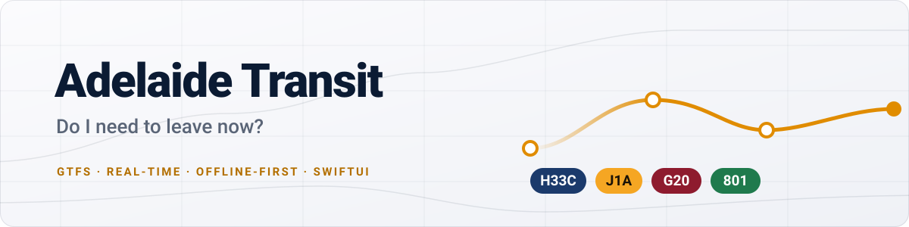
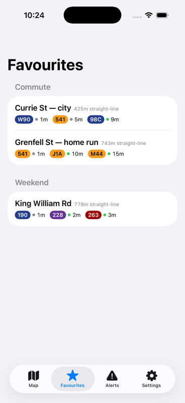
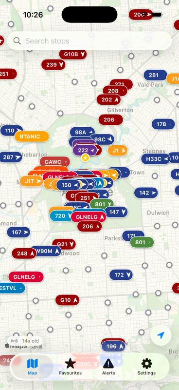
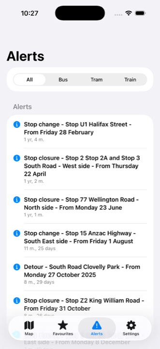
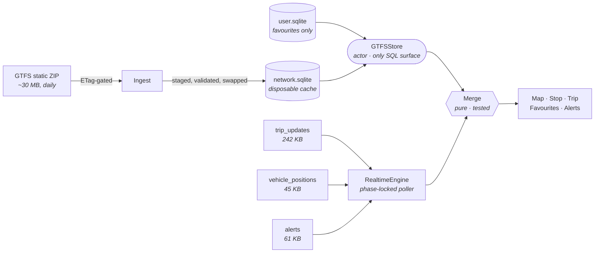

<div align="center">

<picture>
  <source media="(prefers-color-scheme: dark)" srcset="docs/hero-dark.svg">
  <source media="(prefers-color-scheme: light)" srcset="docs/hero-light.svg">
  
</picture>

<br><br>

**A native iOS app for Adelaide Metro that answers one question fast: _do I need to leave now?_**

Live map · real-time departures · walk timing · service alerts<br>
No accounts. No analytics. No backend. No API keys.

<br>


<br>

<table>
<tr>
<td align="center"><sub>STOPS</sub><br><b>9,171</b></td>
<td align="center"><sub>TRIPS</sub><br><b>31,379</b></td>
<td align="center"><sub>FEED CADENCE</sub><br><b>15 s</b></td>
<td align="center"><sub>MAP FRAME COST</sub><br><b>&lt; 2.2 ms</b></td>
<td align="center"><sub>SERVERS</sub><br><b>0</b></td>
<td align="center"><sub>TO BROWSE OFFLINE</sub><br><b>0 bytes</b></td>
</tr>
</table>

</div>

<br>

<div align="center">

<table>
<tr>
<td align="center" width="33%"></td>
<td align="center" width="33%"></td>
<td align="center" width="33%"></td>
</tr>
<tr>
<td align="center"><b>Favourites</b><br><sub>Nearest first, re-sorted live</sub></td>
<td align="center"><b>Live map</b><br><sub>Every vehicle, feed age on screen</sub></td>
<td align="center"><b>Alerts</b><br><sub>Filtered by mode, badged by unseen</sub></td>
</tr>
</table>

<sub>Real screens · real Adelaide Metro data · no mockups</sub>

<br><br>

[**What it is**](#what-it-is) &nbsp;·&nbsp; [**Features**](#features) &nbsp;·&nbsp; [**Install**](#install) &nbsp;·&nbsp; [**How it works**](#how-it-works) &nbsp;·&nbsp; [**What the feed doesn't document**](#what-the-feed-doesnt-document) &nbsp;·&nbsp; [**Performance**](#performance) &nbsp;·&nbsp; [**Privacy**](#privacy)

</div>

---

## What it is

A single-purpose SwiftUI app built on Adelaide Metro's public GTFS feeds. The entire timetable — 9,171 stops, 31,379 trips, every route shape — is ingested into local SQLite on first launch and then works **offline, forever, at zero bytes**. Real-time data is layered on top only when a screen actually needs it.

It is deliberately small: one target, no accounts, no server, no third-party analytics, nothing to sign up for. The interesting part isn't the feature list — it's that almost every decision in it was made against a measurement rather than a guess.

## Features

<table>
<tr>
<td width="50%" valign="top">

### 🗺️ Live map

Every bus, tram and train on the network, culled to your viewport and eased between GPS pings. Stops thin as you zoom — the *most important* stop per grid cell, never a cluster bubble that re-partitions on every pan.

</td>
<td width="50%" valign="top">

### ⏱️ Departures that tell the truth

Every row carries a countdown **and** a clock time — "do I move" and "which service is this" are different questions. Live, scheduled, stale, ghost and cancelled stay five distinct states.

</td>
</tr>
<tr>
<td valign="top">

### 🚶 Walk timing

Routed walking time via MapKit for the stop you're looking at, with an honest warning when you won't make it — and silence when the walk was never plausible.

</td>
<td valign="top">

### 🔁 Block continuation

A question no other app asks: *does this bus carry on under a different route number?* 14,895 of 31,379 trips do. Matched by position, not stop ID, because an interchange is many stops.

</td>
</tr>
<tr>
<td valign="top">

### ⭐ Favourites first

Opens on your starred stops, nearest first, re-sorted live as your location updates. Closure and detour alerts surface on the stop row itself.

</td>
<td valign="top">

### 🔔 Alerts that stop nagging

The tab badge counts *unseen* alerts, not active ones — so a fortnight of roadworks doesn't pin a permanent red dot to your tab bar.

</td>
</tr>
<tr>
<td valign="top">

### 👻 Ghost trips

Services the real-time feed isn't tracking still appear, interpolated along the route shape and drawn faintly, so an untracked bus isn't an invisible one.

</td>
<td valign="top">

### 📴 Offline by default

Timetable browsing costs zero network. The feed is re-downloaded only when the server's `ETag` actually changes.

</td>
</tr>
</table>

## Install

**Requirements** — macOS with **Xcode 26**+ (iOS 26 SDK) · an **iOS 26** device or simulator · [**XcodeGen**](https://github.com/yonaskolb/XcodeGen), because the `.xcodeproj` is generated, not committed.

```bash
git clone https://github.com/RatterAU/AdelaideTransit.git
cd AdelaideTransit/AdelaideTransit

brew install xcodegen     # once
xcodegen generate         # build the .xcodeproj from project.yml
open AdelaideTransit.xcodeproj
```

Then in Xcode:

1. Select the **AdelaideTransit** target → **Signing & Capabilities**.
2. Set **Team** to your own Apple ID. A free account is fine.
3. Change the **Bundle Identifier** to something unique to you (e.g. `com.yourname.adelaidetransit`) — bundle IDs are global, and the default won't be available to you.
4. Pick your iPhone or a simulator and hit **Run**.

> [!NOTE]
> **First launch downloads the full timetable (~30 MB)** and ingests it into SQLite. Give it a minute on Wi-Fi. After that, everything except live vehicle positions works with the network off.

> [!TIP]
> **Free Apple accounts re-sign apps every 7 days** — the app stops launching until you rebuild. A paid Developer Program account raises that to a year. Nothing here requires paid capabilities.

<details>
<summary><b>Building and testing from the command line</b></summary>

<br>

```bash
xcodebuild -project AdelaideTransit.xcodeproj -scheme AdelaideTransit \
  -destination 'generic/platform=iOS Simulator' -quiet build

xcodebuild -project AdelaideTransit.xcodeproj -scheme AdelaideTransit \
  -destination 'platform=iOS Simulator,name=iPhone 17 Pro' test
```

> [!WARNING]
> **Never hand-edit the `.xcodeproj`.** `project.yml` is the source of truth; run `xcodegen generate` after adding any file. If Xcode offers "recommended settings", decline — those belong in `project.yml`, or the prompt returns forever.

</details>

## How it works

Two data paths, one junction. Schedule comes from a daily ZIP; truth about *today* comes from three protobuf feeds. They meet in exactly one place.



Four rules hold the thing together:

|  | Rule | Why |
|:--|:--|:--|
| **1** | **`Merge` is the only place schedule and real-time combine** | Delays, cancellations, tracking state, service-day arithmetic and ghost interpolation are one pure, tested unit — never scattered into a view |
| **2** | **`GTFSStore` (an actor) is the only database surface** | No SQL anywhere else in the app, so query cost and cache invalidation live in one file |
| **3** | **Two database files, and the split is load-bearing** | `network.sqlite` is replaced wholesale by ingest; `user.sqlite` is untouched by it. They were one file once, and a routine timetable update deleted every starred stop |
| **4** | **The staged feed is validated before the swap** | The old database is moved aside rather than deleted — a truncated download is still perfectly valid SQLite |

<details>
<summary><b>Source layout</b></summary>

<br>

```
App/          App entry, tab router, theme + shared formatting rules
Data/
  GTFS/       Zip reader, ingest, SQLite schema + migrations, query surface
  Models/     Departure, LiveVehicle, StopSummary
  Realtime/   Poll scheduler, protobuf decoding, HTML stripping, Merge
Features/
  Map/        MKMapView bridge, stop sheet, trip detail, walking estimates
  Favourites/ Starred stops, live-sorted
  Alerts/     Service alerts, split by what you've starred
  Settings/   Windows, thresholds, clock format
Tests/        Swift Testing — merge logic, poll schedule, formatting, HTML
```

</details>

## What the feed doesn't document

Most of this app's design comes from measuring the real feeds rather than trusting the spec.

| Measured | What the app does about it |
|:--|:--|
| **Publishes every 15 s**, readable ~5 s after its own timestamp. Polling faster returns byte-identical data | Cadence is the only lever on freshness, so the scheduler is **phase-locked to the source clock** rather than ticking on a fixed interval from launch |
| **No `ETag`, no `Last-Modified`, no `Cache-Control`** on real-time, and `Accept-Encoding: gzip` is ignored — every poll is full and uncompressed | Trip updates pre-warm **only on unconstrained Wi-Fi**, never on cellular or Low Data |
| **Nothing carries `current_stop_sequence`** — 0 of 627 entities | "Where is the bus" is derived from the **pruning boundary**: a stop's update disappears once passed, so the smallest published sequence *is* the vehicle. Stable for 790 of 792 trips over five minutes |
| **Absolute arrival times, never a delay field** — 14,098 of 14,098 | A stop with no update of its own is **interpolated** between the nearest known delays either side — which is what lets a recovering bus track 6 min → 3 instead of freezing on the stale figure |
| **No occupancy data** on vehicle positions | There is **no crowding UI**, rather than a fabricated one |
| **All 9,171 stop IDs are numeric** | The SQLite R-tree spatial index keys on `INTEGER` — one non-numeric ID would silently drop a stop from every map query |

## Performance

Every number here was measured, not assumed.

| Number | The decision behind it |
|:--|:--|
| **~235 annotations at peak, < 2.2 ms** to resolve, at 9,171 stops | Stops are thinned at query time by an absolute-anchored grid. Clustering was **rejected** — it re-partitions on every region change, turning a pan into endless merge/split churn |
| **Zero unconditional work** in the map's `updateUIView` | It fires on every render, frame and pan tick, so configuration, polylines and annotations are all change-gated |
| **One bounded range scan** per departures query | The naive version read an entire service day for a stop served by 62 routes and threw most of it away |
| **250 ms debounce**, cancellable (`.task(id:)`) on search | The substring scan is unindexed across all 9,171 stops, and un-ordered replies once left the wrong list on screen |

## Privacy

Your location never leaves the device — it is used for map centring, nearest-stop sorting and walking estimates only. There is no backend, no account, no telemetry and no third-party SDK. The only network traffic is to Adelaide Metro's public GTFS endpoints and Apple's own map and directions services.

## Data & licence

Timetable and real-time data © Department for Infrastructure and Transport, South Australia, published as open GTFS feeds. This project is not affiliated with, endorsed by, or supported by Adelaide Metro.

Code is released under the [MIT Licence](LICENSE).

<div align="center">
<br>
<sub>Built in Adelaide 🇦🇺</sub>
</div>
