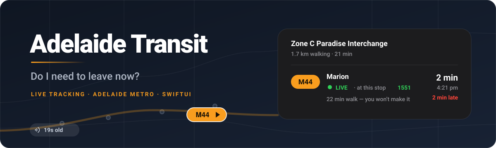
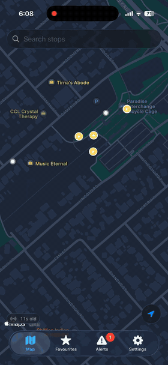
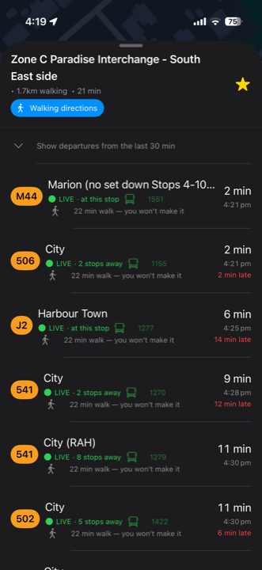
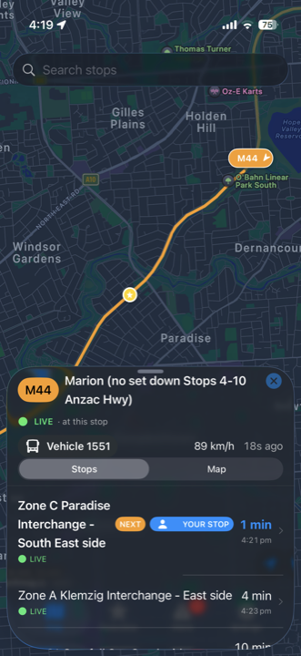
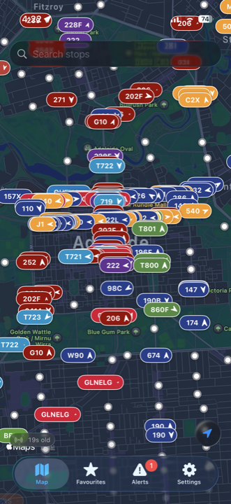
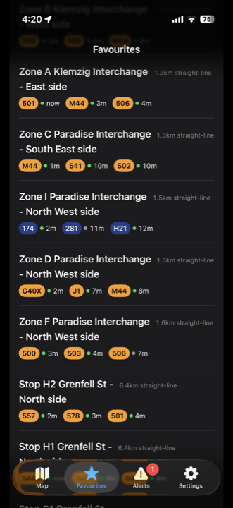
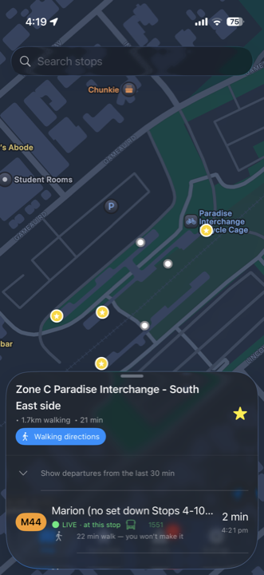
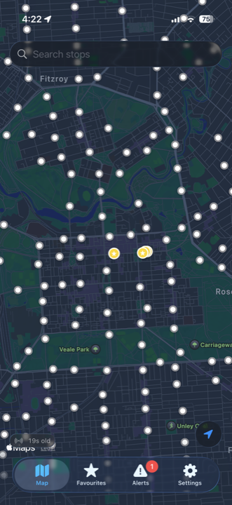
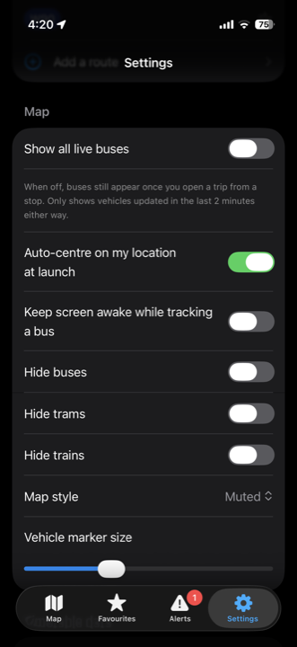
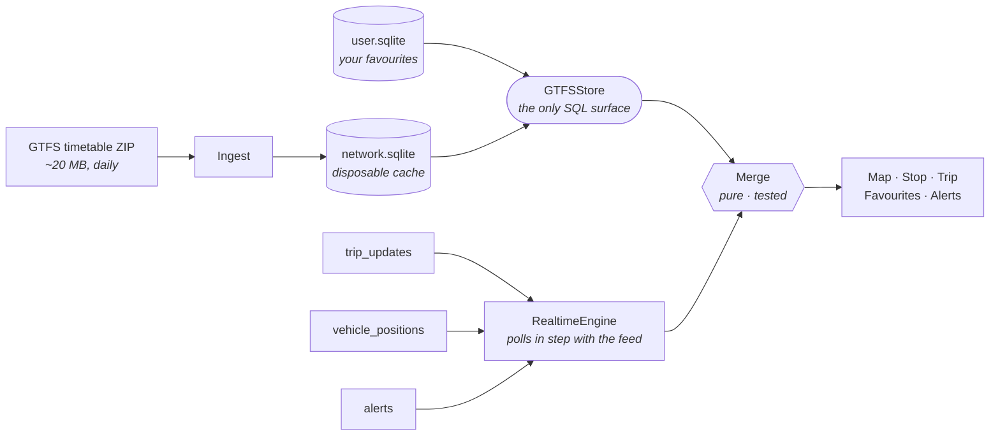

<div align="center">



<br><br>

**An iPhone app that tracks Adelaide Metro buses, trams and trains in real time.**

It exists to answer one question: **do I need to leave now?**

<br>


[**Install it**](#install-it) · [**What it does**](#what-it-does) · [**Under the hood**](#under-the-hood) · [**Privacy**](#privacy)

</div>

---

## Why

Adelaide Metro's own app tells you when a bus is *scheduled*. Standing at a stop in the rain, that is the wrong number. I wanted the one that matters: where the bus actually is right now, how late it actually is, and whether I can still make it on foot.

So I built it. It's a personal project — one person, no company behind it, no accounts, no ads, no backend to pay for. Everything happens on your phone, talking straight to Adelaide Metro's public data feeds.

<br>

<div align="center">



<sub>Tap a stop → live departures → tap one → follow the actual bus.</sub>

</div>

<br>

<div align="center">


&nbsp;

&nbsp;


<sub><b>Departures</b> · <b>Follow the bus</b> · <b>Everything moving, right now</b></sub>

<br>

<sub>Real screenshots. Real Adelaide data. Nothing mocked up.</sub>

</div>

## What it does

**See where the bus actually is.** Every tracked vehicle on the network appears on the map as its route number with a heading arrow, sliding between GPS updates. Tap one and you follow it: its speed, how many seconds ago it reported, and every stop still ahead of it.

**Know which bus it is.** Tap the vehicle number on a trip and it opens up: rego, chassis and body, when it was built and how old it is, seats, depot, operator and its history. There's a photo too — of that exact bus when one exists on Wikimedia Commons, otherwise one of the same model, and the caption tells you which. Where a bus reports how full it is, you'll see that as well: on the trip, and as a small icon on its departure row.

**Know if you'll make it.** Each departure shows a countdown *and* a clock time, because "5 min" and "4:21 pm" answer different questions. If you're too far away to catch it on foot, the app says so plainly instead of letting you jog for nothing.

**Know when it's late.** Delays come from the live feed and are colour-coded: on time, running early, running late. If a bus is recovering from a delay, the number counts down with it rather than freezing on a stale figure.

**Your stops first.** The app opens on the stops you've starred, sorted by how close you are, re-sorting as you move. Each shows the next three departures, so most of the time you're done before you've tapped anything.

**Alerts that don't nag.** Diversions and closures are listed and filtered by mode, and the tab badge counts alerts you *haven't seen* — so a fortnight of roadworks doesn't leave a permanent red dot on your screen.

**It looks like it belongs on iOS 26.** Built in SwiftUI against the current design language, so the search field, the feed-age chip and the locate button are real Liquid Glass — they pick up and refract the map moving underneath them instead of sitting on a flat grey slab. Nothing here is a custom re-skin of Apple's controls.

**Buses that aren't being tracked still show up.** When the feed loses a vehicle, the app estimates where it should be from the timetable and draws it faintly, rather than pretending the service doesn't exist.

<br>

<div align="center">

<table>
<tr>
<td align="center" width="20%"></td>
<td align="center" width="20%"></td>
<td align="center" width="20%"></td>
<td align="center" width="20%"></td>
<td align="center" width="20%"></td>
</tr>
<tr>
<td align="center"><sub><b>Favourites</b><br>Nearest first</sub></td>
<td align="center"><sub><b>Any stop</b><br>Walk time included</sub></td>
<td align="center"><sub><b>9,171 stops</b><br>Thinned, never clustered</sub></td>
<td align="center"><sub><b>Alerts</b><br>Badged by unseen</sub></td>
<td align="center"><sub><b>Yours</b><br>Tune what shows</sub></td>
</tr>
</table>

</div>

## Install it

There's no App Store listing — publishing needs a paid Apple developer account and this is a free side project. You install it by building it yourself, which takes about ten minutes and costs nothing.

### What you need first

| | |
|:--|:--|
| **A Mac** | Any Mac running macOS Tahoe or later |
| **Xcode 26 or newer** | Free from the [Mac App Store](https://apps.apple.com/app/xcode/id497799835). It's a big download — start it now |
| **An iPhone on iOS 26** | Plus its USB cable, for the first install |
| **An Apple ID** | The free one you already have is fine. No paid developer account needed |

### Step 1 — Get the code

Open **Terminal** and paste this in, one block:

```bash
git clone https://github.com/RatterAU/AdelaideTransit.git
cd AdelaideTransit/AdelaideTransit
```

### Step 2 — Generate the Xcode project

The `.xcodeproj` isn't stored in this repo — it's generated from `project.yml`, so it has to be built once:

```bash
brew install xcodegen     # only needed the first time
xcodegen generate
open AdelaideTransit.xcodeproj
```

<sub>No Homebrew? Install it from <a href="https://brew.sh">brew.sh</a> first, then run the above.</sub>

<details>
<summary><b>Optional — bus details (rego, model, photo)</b></summary>

<br>

The live feed only says a bus's fleet number. Everything else comes from a snapshot of the [Australian Bus Fleet Lists](https://fleetlists.busaustralia.com/index-sa.php), an enthusiast-run site whose terms allow reference use, so the snapshot isn't published in this repo. Build your own copy, for your own phone:

```bash
python3 ../scripts/fleet_snapshot.py   # writes Resources/fleet.json, ~1,100 buses
xcodegen generate
```

Skip it and the app works exactly the same, minus the bus-details card. Re-run it now and then as the fleet changes.

</details>

### Step 3 — Tell Xcode it's yours

Xcode is now open. In the left sidebar click the blue **AdelaideTransit** project icon at the very top, then:

1. Select the **AdelaideTransit** target → the **Signing & Capabilities** tab
2. Tick **Automatically manage signing**
3. **Team** → *Add an Account…* → sign in with your Apple ID → pick it from the dropdown
4. Change **Bundle Identifier** to something unique to you, e.g. `com.yourname.adelaidetransit`

<sub>Step 4 matters: bundle IDs are global, so the default one won't be available to your account.</sub>

### Step 4 — Run it on your phone

1. Plug your iPhone in and unlock it. Tap **Trust** if asked
2. In Xcode's toolbar, click the device dropdown (next to the app name) and pick your iPhone
3. Press **⌘R**, or the ▶ button

The first build takes a few minutes.

### Step 5 — Trust the app on your iPhone

The first launch will fail with *"Untrusted Developer"*. That's expected. On your iPhone:

**Settings → General → VPN & Device Management → your Apple ID → Trust**

Open the app again and it works.

> [!NOTE]
> **First launch downloads the whole timetable (~20 MB)** and files it away on your phone. Give it a minute on Wi-Fi. After that, screens open instantly and only live positions need the network.

> [!IMPORTANT]
> **With a free Apple ID, the app stops opening after 7 days.** This is Apple's rule, not the app's — free signing certificates expire weekly. To keep using it, plug the phone in and press **⌘R** again; your favourites and settings survive. A paid Apple Developer account extends this to a year.

<details>
<summary><b>If something goes wrong</b></summary>

<br>

| Problem | Fix |
|:--|:--|
| `xcodegen: command not found` | `brew install xcodegen`, then reopen Terminal |
| *"Failed to register bundle identifier"* | Someone already used that bundle ID. Change it to something more unique in Signing & Capabilities |
| *"Untrusted Developer"* on launch | Step 5 above — the trust setting on the iPhone |
| App won't open after a week | Expected on a free account. Rebuild with ⌘R |
| Xcode offers to *"Update to recommended settings"* | Decline. Project settings live in `project.yml`, and accepting makes the prompt come back forever |
| Build errors after you add a file | Run `xcodegen generate` again |

</details>

<details>
<summary><b>Running the tests</b></summary>

<br>

```bash
xcodebuild -project AdelaideTransit.xcodeproj -scheme AdelaideTransit \
  -destination 'platform=iOS Simulator,name=iPhone 17 Pro' test
```

114 tests, Swift Testing (one skips without the fleet snapshot). `project.yml` is the source of truth for the project — run `xcodegen generate` after adding any file, and never hand-edit the `.xcodeproj`.

</details>

## Under the hood

Two feeds, one junction. The timetable arrives once a day as a big ZIP and goes into local SQLite. The live picture arrives every 15 seconds as three protobuf feeds. They're combined in exactly one place, `Merge`, which is pure code with tests around it — no view ever does this arithmetic itself.



Three decisions carry most of the weight:

- **Your favourites live in a separate database file from the timetable.** They were one file once, and a routine timetable update wiped every starred stop. Now ingest can replace the whole network database and never touch yours.
- **A new timetable is validated before it replaces the old one**, and the old file is moved aside rather than deleted. A half-finished download is still perfectly valid SQLite, which is exactly what makes it dangerous.
- **All the schedule/real-time reconciliation is in one tested file.** Delays, cancellations, service-day maths, "is this actually live", estimated positions for untracked buses — one place, so there's one place to be wrong.

<details>
<summary><b>Things the feed doesn't tell you, that I had to measure</b></summary>

<br>

Most of the app's design came from poking at the real feeds rather than trusting the spec.

| What's actually true | What the app does about it |
|:--|:--|
| The feed publishes every **15 seconds** and is readable ~5 s after its own timestamp. Polling faster returns byte-identical data | The poller locks onto the feed's own clock instead of ticking on its own schedule, so a refresh lands just after new data exists |
| **No `ETag`, no `Last-Modified`**, and gzip is ignored — every poll is a full, uncompressed download | Pre-fetching happens only on unconstrained Wi-Fi, never on cellular or Low Data |
| **Nothing reports which stop a bus is at** — 0 of 627 vehicles carry that field | Position is inferred from which stops have dropped out of the trip's update list: the lowest one still published *is* where the bus is. Held for 790 of 792 trips over five minutes |
| **Predicted arrival times are absolute, and a delay figure is never sent** — 14,098 out of 14,098 | Delay is computed, and stops without their own prediction are interpolated between the nearest known ones. That's what lets a recovering bus tick 6 min late → 3, instead of freezing |
| **Crowding is reported by only a few buses** — none until recently, 26 of 413 when last measured | Shown where a bus reports it, and nowhere else. No guesses for the rest |
| **The vehicle field is just a fleet number** — no rego, no model | Rego, model, age and photo come from a separate fleet snapshot, looked up by that number |
| **Route types aren't only the basic GTFS codes** — 319 bus routes, including every school route, are filed as 701 or 712 rather than 3 | They're folded back to "bus" in one place, so hiding buses or filtering alerts by mode catches all of them |
| 14,895 of 31,379 trips **continue under a different route number** (a 502 becomes a 110 at Grenfell St) | The app follows the vehicle through the change — matched by position rather than stop ID, because an interchange is a dozen stops with different IDs |

</details>

<details>
<summary><b>Why the map stays smooth with 9,171 stops</b></summary>

<br>

- Stops are **thinned, not clustered**: the busiest stop in each grid square survives, and the grid is anchored to fixed coordinates. Clustering re-partitions on every pan, which turns a drag into endless merge/split churn. Starred stops always survive the thinning.
- The map view does **no unconditional work** on redraw — it's called on every frame and every pan tick, so everything it does is gated on something having actually changed.
- Departure queries are **bounded in SQL**. The naive version read an entire service day for a stop served by 62 routes and threw nearly all of it away.
- Search is **debounced and cancellable**, because it's an unindexed substring scan over every stop and out-of-order replies used to leave the wrong list on screen.

</details>

<details>
<summary><b>Source layout</b></summary>

<br>

```
App/          App entry, tab router, theme + shared formatting
Data/
  GTFS/       Zip reader, ingest, SQLite schema + migrations, queries
  Models/     Departure, LiveVehicle, StopSummary, Fleet
  Realtime/   Poll scheduler, protobuf decoding, HTML stripping, Merge
Features/
  Map/        MKMapView bridge, stop sheet, trip detail, walk estimates
  Favourites/ Starred stops, live-sorted
  Alerts/     Service alerts
  Settings/   Windows, thresholds, clock format
Tests/        Swift Testing
../scripts/   fleet_snapshot.py — builds the optional fleet snapshot
```

</details>

## Privacy

Your location never leaves your phone. It's used for centring the map, sorting stops by distance and estimating walk times — nothing else. There is no account, no backend, no analytics and no third-party SDK. The only network traffic is to Adelaide Metro's public feeds, to Apple for maps and walking directions, and to Wikimedia Commons when you open a bus's details and its photo loads.

## Data & licence

Timetable and real-time data © Department for Infrastructure and Transport, South Australia, published as open GTFS feeds. This project is not affiliated with or endorsed by Adelaide Metro.

Bus details come from the [Australian Bus Fleet Lists](https://fleetlists.busaustralia.com/), built locally and not redistributed here. Bus photos are from [Wikimedia Commons](https://commons.wikimedia.org/wiki/Category:Buses_in_Adelaide) under their own free licences (CC0, CC BY, CC BY-SA). The app shows each photographer and licence and links to the original.

Code is MIT licensed — see [LICENSE](LICENSE).

<div align="center">
<br>
<sub>Built in Adelaide 🇦🇺</sub>
</div>
